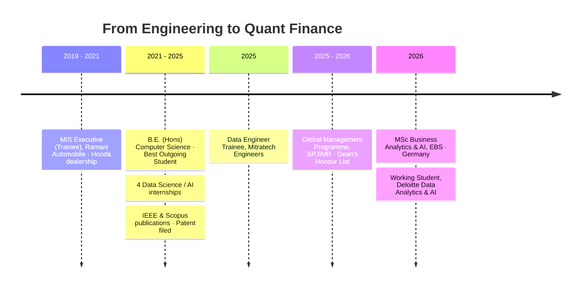

<!-- ===================== HEADER ===================== -->
<p align="center">
  
</p>

<p align="center">
  
</p>

<p align="center">
  <a href="https://www.linkedin.com/in/contactharshithbabu"></a>
  <a href="mailto:harshithbabu2001@gmail.com"></a>
  
  
</p>

---

## 👨‍💻 About Me

```python
class HarshithBabu:
    def __init__(self):
        self.role        = "Aspiring Quantitative Analyst"
        self.now         = ["MSc Business Analytics & AI @ EBS Universität",
                            "Working Student, Data Analytics & AI @ Deloitte (from Dec 2026)"]
        self.background  = ["B.E. (Hons) Computer Science", "GMP '26 @ SPJIMR Mumbai"]
        self.based_in    = "Germany"
        self.target      = "Quant roles in the DACH / Frankfurt finance sector"
        self.languages   = {"code": ["Python", "R", "SQL"],
                            "spoken": ["English", "Deutsch (learning)"]}

    def philosophy(self):
        return "A model is only as good as the decision it improves."
```

I started as a computer science engineer, added a management degree at one of India's top business schools, and now work on the overlap of **statistics, machine learning and markets**.
I enjoy messy data, careful validation, and explaining a model's output to the people who have to act on it.

---

## 🔭 Right Now

| | |
|---|---|
| 💼 **Joining** | Deloitte Frankfurt, Data Analytics & AI team, as a Working Student (Dec 2026) |
| 📈 **Competing** | Bloomberg Global Trading Challenge 2026: covering the **Hang Seng** in a 5-person team |
| 🧪 **Researching** | GenAI adoption by retail investors: PLS-SEM study, **N = 511**, trust vs. perceived risk |
| 🎓 **Studying** | MSc Business Analytics & AI (EBS) · Diploma in Data Science (IIT Madras, part-time) |
| 🇩🇪 **Learning** | German, one *Satz* at a time |

---

## 🧭 Journey



<details>
<summary><b>💼 Experience (click to expand)</b></summary>
<br>

| Role | Organisation | Period |
|------|--------------|--------|
| **Working Student, Data Analytics & AI** | Deloitte, Frankfurt | Dec 2026 – present |
| **Data Engineer Trainee** | Mitratech Engineers, Kochi | Jun 2025 – Dec 2025 |
| **Data Science / AI Intern** | Teachnook · Mitratech · Quizaro · Externsclub | 2021 – 2025 |
| **Trainee, MIS Executive** | Ramani Automobile Pvt Ltd (Honda), Coimbatore | Jun 2019 – Jul 2021 |

</details>

<details>
<summary><b>🎓 Education (click to expand)</b></summary>
<br>

| Programme | Institution | Highlights |
|-----------|-------------|------------|
| **MSc Business Analytics & AI** | EBS Universität für Wirtschaft und Recht, Germany | Ongoing |
| **Global Management Programme** | S.P. Jain Institute of Management & Research, Mumbai | CGPA 3.78 / 4.00 · Dean's Honour List |
| **Diploma in Data Science** | IIT Madras (part-time) | Ongoing |
| **B.E. (Hons) Computer Science** | 2021 – 2025 | Best Outgoing Student, CSE |

</details>

---

## 🎯 Areas of Focus

<table>
<tr>
<td width="50%" valign="top">

**📊 Quantitative Finance**
- Portfolio construction & equity analysis
- Time-series modelling & forecasting
- Risk analytics & backtesting

**🤖 Machine Learning**
- Supervised learning & model evaluation
- Deep learning (CNNs) for classification
- Explainability & validation

</td>
<td width="50%" valign="top">

**📐 Statistics & Econometrics**
- Structural equation modelling (PLS-SEM)
- Hypothesis testing & survey analytics
- Regression & causal reasoning

**🏗️ Data Engineering & BI**
- ETL pipelines & SQL data modelling
- Dashboards for business decisions
- MIS reporting

</td>
</tr>
</table>

---

## 🛠️ Tech Stack

**Languages**
<p>
  
</p>

**Data Science & ML**
<p>
  
  <br>
  
  
  
  
  
</p>

**Finance, Analytics & BI**
<p>
  
  
  
  
  
</p>

**Tools & Platforms**
<p>
  
</p>

---

## 📚 Research & Patents

| Year | Title | Venue |
|:----:|-------|-------|
| 2025 | **Predictive AI for Art Investment and Valuation** | *ShodhKosh: Journal of Visual and Performing Arts* |
| 2023 | **Detection of Abnormalities in Chest X-Rays Using CNNs** | IEEE ICPSITIAGS |
| 2023 | **Examining the Potential Benefits and Challenges of Utilizing AI for Big Data Analysis** | IEEE SMART GENCON |
| 2023 | **Application of AI Tools for Better Rehabilitation Purposes** | *J. for Re Attach Therapy & Developmental Diversities* · Scopus |
| 2023 | **AI-based Internet Firewall for Trusted System using Naïve Bayesian Classification** | 🇮🇳 Indian Patent App. No. 20234162405 · *pending* |

**🧪 In progress:** *Blind Faith or Calculated Risk? Trust as the Dominant Driver of Generative AI Continuance Intention among Retail Investors*: mixed-methods study (PLS-SEM, N = 511, plus qualitative analysis of ~390 open-ended responses).

---

## 🏆 Honours & Achievements

- 🥇 **Asia's Most Promising Researcher Award**, AIRA 2023
- 🎖️ **Dean's Honour List**, Global Management Programme, SPJIMR
- 🏅 **Best Outgoing Student**, B.E. Computer Science
- 🛡️ **NCC Air Force Wing**: Director General Commendation · national-level Best Cadet awards
- 🌏 **Youth Ambassador of India**: overseas deployment with the NCC

---

## 📊 GitHub Analytics

<p align="center">
  
  
</p>

<p align="center">
  
</p>

<p align="center">
  
</p>

<p align="center">
  <picture>
    <source media="(prefers-color-scheme: dark)" srcset="https://raw.githubusercontent.com/YOUR_GITHUB_USERNAME/YOUR_GITHUB_USERNAME/output/github-snake-dark.svg" />
    
  </picture>
</p>

---

## 🤝 Let's Talk About

`Quant research` · `Market microstructure` · `ML for trading` · `Risk modelling` · `Analytics careers in Germany` · `Moving from engineering to finance`

---

<p align="center">
  <i>"In God we trust. All others must bring data."</i> ~ W. Edwards Deming
</p>

<p align="center">
  
</p>
